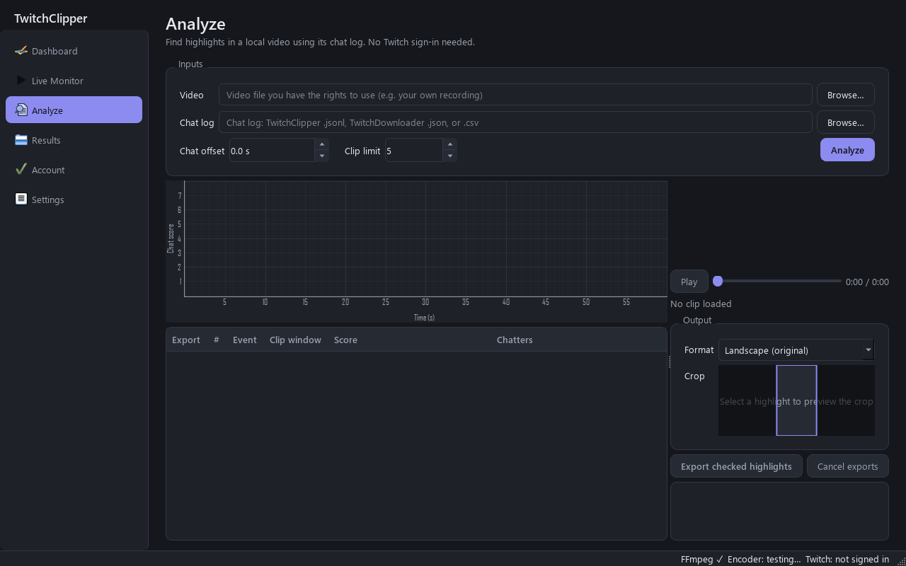

# Stream Clip Studio

Find the best moments in Twitch streams, turn them into captioned vertical clips, and publish them with **your own accounts**. Everything runs on your computer.

[](https://github.com/myk-glitch/stream-clip-studio/actions/workflows/ci.yml)
[](LICENSE)

The repository contains two tools. You can use either one on its own.

| | **Pipeline** (`pipeline/`) | **Desktop app** (`desktop/`) |
|---|---|---|
| Best for | Watching live streams and posting clips | Cutting clips from a video you already have |
| Interface | Command line | Windows desktop app |
| Finds moments from | Live Twitch chat | A chat log file, or your "Clip that" button |
| Publishes clips | YouTube Shorts, TikTok pack | No, it exports files |
| Runs on | Windows, Linux (macOS untested) | Windows 10/11 |



> **Only clip and post content you have permission to use.** Follow each streamer's rules and the terms of Twitch, YouTube and TikTok. You are responsible for what you publish.

## Contents

- [Features](#features)
- [Requirements](#requirements)
- [Install the pipeline](#install-the-pipeline)
- [Connect your accounts](#connect-your-accounts)
- [Use the pipeline](#use-the-pipeline)
- [Automatic posting](#automatic-posting)
- [Install and run the desktop app](#install-and-run-the-desktop-app)
- [Project structure](#project-structure)
- [Troubleshooting and FAQ](#troubleshooting-and-faq)
- [Known limitations](#known-limitations)
- [Contributing and license](#contributing-and-license)

## Features

**Pipeline**
- **Live clipping:** records a rolling buffer and cuts a clip when chat suddenly spikes, while the stream is still on.
- **Smart filters:** ignores bots, commands, one-word poll answers and spam, and automatically drops letterboxed cutscenes.
- **Local captions:** word-by-word captions with Whisper, with no AI service or API key.
- **Vertical editor:** blurred 9:16 or face-on-top, gameplay-on-bottom layouts, one-word captions and your own sound effects.
- **VOD tools:** list past broadcasts, find a channel's top clips, and re-cut a moment with more context.
- **YouTube Shorts:** uploads through the official API with your own Google project.
- **TikTok:** prepares the video and caption for you to post in the app.
- **Posting schedule:** daily limits, minimum spacing, a queue and optional automatic posting.
- **Discord (optional):** live alerts, clips to post, posted clips and a daily recap.

**Desktop app**
- Analyzes a local video with its chat log and ranks the highlights.
- Exports landscape or 9:16 clips with hardware encoding when available.
- Keeps a rolling capture from a camera, capture card, OBS Virtual Camera or your screen, with a **Clip that** button.
- Includes a clip library with preview, import and delete.

## Requirements

| Needed for | Requirement |
|---|---|
| Everything | [Git](https://git-scm.com/downloads) and [FFmpeg](https://ffmpeg.org/download.html) 7 or newer on your PATH |
| Pipeline | [Python](https://www.python.org/downloads/) 3.11 or 3.12, about 2 GB of disk space, and more for clips |
| Desktop app | Windows 10/11 and [uv](https://docs.astral.sh/uv/getting-started/installation/) |
| Optional | An NVIDIA GPU makes captions faster. The CPU works too |

Install FFmpeg:

```powershell
winget install Gyan.FFmpeg
```

On Linux use `sudo apt install ffmpeg`, and on macOS use `brew install ffmpeg`. Open a **new** terminal afterward, then check it with `ffmpeg -version`.

## Install the pipeline

**1. Download the project**

```powershell
git clone https://github.com/myk-glitch/stream-clip-studio.git
```

```powershell
cd stream-clip-studio\pipeline
```

**2. Create an isolated Python environment**

Windows:

```powershell
python -m venv .venv
```

```powershell
.\.venv\Scripts\Activate.ps1
```

Linux or macOS:

```bash
python3 -m venv .venv && source .venv/bin/activate
```

**3. Install the dependencies**

```powershell
python -m pip install -r requirements.txt
```

**4. Create your settings files**

```powershell
python configure.py init
```

This creates `config.toml` for preferences and `.env` for credentials. Git ignores both.

**5. Add a streamer**

Open `config.toml` and replace the example block with a channel you have permission to clip:

```toml
[streamers.their_twitch_login]
tag = "THEIRNAME"
display_name = "Their Name"
watch = true
```

**6. Check your setup**

```powershell
python configure.py doctor
```

`[FAIL]` lines must be fixed. `[note]` lines are optional features you haven't set up yet. The doctor never prints a secret.

You can now clip a live stream with no accounts at all:

```powershell
python live_clipper.py their_twitch_login
```

The first run downloads the Whisper caption model.

## Connect your accounts

Connect only what you plan to use. Each person uses their **own** developer apps and accounts, and this project never asks for your account passwords. **[The credentials guide](docs/credentials.md)** has click-by-click steps.

| Service | Enables | What you create | Where it goes |
|---|---|---|---|
| **Twitch** | Live alerts, top clips, VOD listing | A free app with a Client ID and Secret | `.env` or keychain |
| **YouTube** | Uploading Shorts | A Google Cloud OAuth client (Desktop app) | A file outside the repo |
| **YouTube API key** | View counts in the recap | An API key | `.env` or keychain |
| **Discord** | Notifications | Up to 5 channel webhooks | `.env` or keychain |
| **TikTok** | Nothing to connect by default | You post the prepared clip in the app | Not needed |

Sign in to YouTube through Google's own page:

```powershell
python post_youtube.py auth
```

To keep a credential out of `.env`, store it in your operating system's keychain with a hidden prompt:

```powershell
python configure.py secret TWITCH_CLIENT_SECRET
```

Test what you connected:

```powershell
python configure.py doctor --online
```

```powershell
python notify.py test
```

## Use the pipeline

Run these from the `pipeline` folder with the environment active.

**Watch a live stream.** This restarts after connection drops:

```powershell
python keepalive.py their_twitch_login --hours 6 -- --model base --before 30 --after 10
```

On Windows you can also double-click `Start Live Clipper.bat`. Clips appear in `clips/<channel>_<date>_<time>/`.

| File | What it is |
|---|---|
| `clip_9x16.mp4` | Vertical clip with captions |
| `clip_16x9.mp4` | Original wide clip |
| `captions.srt` | Editable captions |
| `info.json` | Spike size and a sample of chat |

**Find moments in past streams:**

```powershell
python top_clips.py their_twitch_login LAST_WEEK
```

```powershell
python vod.py list their_twitch_login
```

```powershell
python vod.py clip their_twitch_login --vod 123456789 --at 1:23:45
```

**Re-cut a clip with more context** after the stream ends:

```powershell
python rewind.py clips\their_twitch_login_20260101_120000 --before 45 --after 15
```

**Make a face-on-top edit.** Save the streamer's `cam` and `game` boxes in `config.toml` first ([how to find them](docs/configuration.md#finding-the-camera-and-gameplay-boxes)):

```powershell
python split_layout.py clips\my_clip --channel their_twitch_login --start 4 --end 16 --out clips\READY_TO_POST\my_clip.mp4
```

**Publish it.** Uploads use `posting.privacy` from `config.toml`, which starts as `private`:

```powershell
python post_everywhere.py clips\READY_TO_POST\my_clip.mp4 --hook "He did NOT see that coming 😭" --streamer THEIRNAME
```

This uploads to YouTube and puts the video and caption in `clips/TIKTOK_TO_POST/` for you to post in the TikTok app. If your daily limit is reached, a public clip waits in `clips/QUEUE/`.

## Automatic posting

Automatic posting is **off by default** and only publishes clips you've placed in the queue. It never posts raw clips from the watcher.

1. Set your schedule in `config.toml`:

   ```toml
   [posting]
   privacy = "public"
   max_posts_per_day = 2
   min_hours_between_posts = 4

   [auto_post]
   enabled = true
   start_hour = 9
   end_hour = 22
   ```

2. Preview what would happen:

   ```powershell
   python post_queue.py --dry-run
   ```

3. Schedule it. On Windows:

   ```powershell
   .\schedule_windows.ps1 -AutoPost -Alerts -Recap -RecapTime 21:00
   ```

   Remove the tasks at any time with `.\schedule_windows.ps1 -Remove`. For Linux and macOS, see [the cron setup](docs/configuration.md#scheduling).

## Install and run the desktop app

```powershell
cd stream-clip-studio\desktop
```

```powershell
uv sync --frozen
```

```powershell
uv run --frozen python -m twitchclipper
```

No account is needed for local analysis, exports or capture. [The desktop guide](desktop/README.md) explains each page.

## Project structure

```text
stream-clip-studio/
├── pipeline/                 Command-line clipping and posting
│   ├── config.example.toml   Copy of every preference, with comments
│   ├── .env.example          Credential placeholders
│   ├── configure.py          Setup, health check, keychain storage
│   ├── settings.py           Loads settings and secrets
│   ├── live_clipper.py       Live clip detection and rendering
│   ├── keepalive.py          Restarts the watcher after drops
│   ├── vod.py, rewind.py     Past-broadcast tools
│   ├── top_clips.py          Most-viewed Twitch clips
│   ├── split_layout.py       Face-on-top editor
│   ├── post_everywhere.py    Publish, limits and queue
│   ├── post_youtube.py       YouTube upload and sign-in
│   ├── post_queue.py         Automatic posting
│   ├── notify.py             Discord messages
│   ├── live_alert.py         Live alerts and auto-watch
│   ├── recap.py              Daily recap
│   ├── twitch_api.py         Official Twitch API client
│   ├── tools/legacy/         Optional older helpers
│   └── tests/
├── desktop/                  Windows desktop app (PySide6)
│   ├── src/twitchclipper/
│   ├── scripts/
│   └── tests/
├── docs/                     Credentials, configuration, troubleshooting
├── scripts/check_secrets.py  Pre-publish privacy scan
└── .github/                  CI and contribution templates
```

## Troubleshooting and FAQ

**`ffmpeg` isn't recognized.** Install it, then open a new terminal so your PATH updates.

**PowerShell won't run `Activate.ps1`.** Skip activation and call the environment directly, for example `.\.venv\Scripts\python.exe configure.py doctor`.

**"Twitch isn't configured."** Add your Client ID and Secret. Plain live clipping doesn't need them, but alerts and VOD listing do.

**No clips appear.** Chat may not be spiking. Lower the threshold for smaller channels with `--min-msgs 8` or `--spike 2`.

**Do I have to use YouTube, TikTok or Discord?** No. Each one is optional.

**Will this post without me?** Only if you turn on `auto_post.enabled`, and only clips in your queue.

More answers are in **[the troubleshooting guide](docs/troubleshooting.md)**.

## Known limitations

- **Live clipping can't go back in time.** It only captures what happens while it's running.
- **A chat spike isn't always a good moment.** Watch every clip before you publish it.
- **TikTok has no automatic upload by default.** The optional `autotok` integration is unofficial, off by default, and may violate TikTok's terms or get posts suppressed.
- **VOD chat scanning and exact rewind are unofficial and off by default.** They use Twitch's private web API, which can change at any time.
- **The official Twitch API doesn't report a VOD's game,** so `vod.py list --game` matches video titles unless the unofficial option is on.
- **Video downloads use [Streamlink](https://streamlink.github.io/),** which depends on how Twitch serves video and may need updates.
- **Sound effects aren't included,** because their licenses vary. [Add your own](pipeline/sfx/README.md).
- **New accounts may get little reach.** This tool doesn't guarantee views or earnings.
- **macOS is untested.** Linux runs the automated pipeline tests. The desktop app is Windows-only.
- **YouTube sign-in needs an OS keychain,** so headless servers need extra setup.

## Contributing and license

Contributions are welcome. See [CONTRIBUTING.md](CONTRIBUTING.md), [SECURITY.md](SECURITY.md) and the [changelog](CHANGELOG.md).

Released under the [MIT License](LICENSE). The pipeline is based on [live-clipper](https://github.com/akm72-bit/live-clipper) by tokenstoviews, also MIT. Third-party components are listed in [THIRD_PARTY_NOTICES.md](THIRD_PARTY_NOTICES.md).

Not affiliated with Twitch, YouTube, Google, TikTok, Discord, Rockstar Games or Take-Two.
