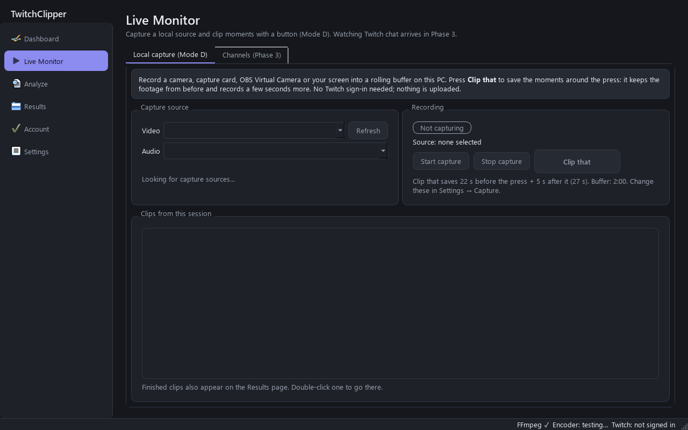

# Desktop app (TwitchClipper)

A free, local Windows app that finds highlight moments from **chat activity** and cuts them into clips.



- **Works without any account:** analyze a local video with its chat log, then export landscape or 9:16 clips.
- **Official Twitch access only:** optional sign-in uses the Device Code flow. The app doesn't download live or VOD video through undocumented endpoints.
- **Fast exports:** NVIDIA NVENC, Intel Quick Sync or AMD AMF when available, with CPU fallback.

## Requirements

- Windows 10 or 11
- [uv](https://docs.astral.sh/uv/getting-started/installation/)
- FFmpeg 7 or newer (`winget install Gyan.FFmpeg`). The app can also download a pinned build for you.

## Install and run

From this `desktop` folder:

```powershell
uv sync --frozen
```

```powershell
uv run --frozen python -m twitchclipper
```

uv installs the right Python version (3.12) and the dependencies into a local `.venv`.

## Analyze a video

1. Choose a video you have the rights to use, and its chat log. Supported logs:
   - TwitchClipper `.jsonl`
   - TwitchDownloader `.json`
   - `.csv` with `offset_seconds,user,message`
2. Set the chat offset if the log and video don't start at the same moment.
3. Click **Analyze**. Highlights are ranked by chat activity, and your clip limit keeps the strongest.
4. Check the moments you want, pick landscape, portrait 9:16 (drag the crop box) or both, and click **Export**.

Clip timing: estimated event = start of the chat burst − viewer delay (5 s) − reaction time (3 s). Each clip covers 22 s before and 5 s after the event. You can change these in **Settings → Timing**.

## Results page

- Lists exported clips with preview, **Open**, **Show in folder** and **Delete**.
- **Import video…** copies a video into `<clips folder>\imported\`. The original is never changed.
- To try it with a synthetic sample, create one and import it from `test_media/`:

  ```powershell
  uv run --frozen python scripts/make_test_media.py
  ```

## Local capture and Clip that

On **Live Monitor → Local capture**:

- Pick a camera, capture card, OBS Virtual Camera, your screen or the built-in test pattern, and optionally a microphone.
- **Start capture** keeps a rolling buffer (2 minutes by default) on your PC.
- **Clip that** saves 22 s before the press and 5 s after. Recording continues while the clip is saved.
- Lengths are in **Settings → Capture**. No sign-in is needed and nothing is uploaded.
- Sound playing on the PC can only be captured if Windows offers a device for it, such as "Stereo Mix".

## Optional Twitch sign-in

Create a free app at the [Twitch Developer Console](https://dev.twitch.tv/console/apps) with **Client Type: Public** and redirect URL `http://localhost`. Paste its **Client ID** on the **Account** page and click **Sign in with Twitch**. Your token is stored in Windows Credential Manager.

Phase 2 (VOD workflow) and Phase 3 (live monitoring through EventSub) aren't finished. The Live Monitor's channel list is in place for them.

## Where files go

- Settings: `%APPDATA%\TwitchClipper\settings.toml`
- Database and logs: `%LOCALAPPDATA%\TwitchClipper\`. The capture buffer is in its `buffer` folder and is cleared when the app closes.
- Clips: `Videos\TwitchClipper` (changeable in Settings)

## Tests

```powershell
uv sync --frozen
```

```powershell
uv run --frozen pytest -q
```

The suite uses real FFmpeg and takes about 8 minutes. It generates its own synthetic media.

## Command line

```powershell
uv run --frozen python -m twitchclipper --help
```

Debug commands: `doctor`, `hwtest`, `analyze`, `export` and `import`.
